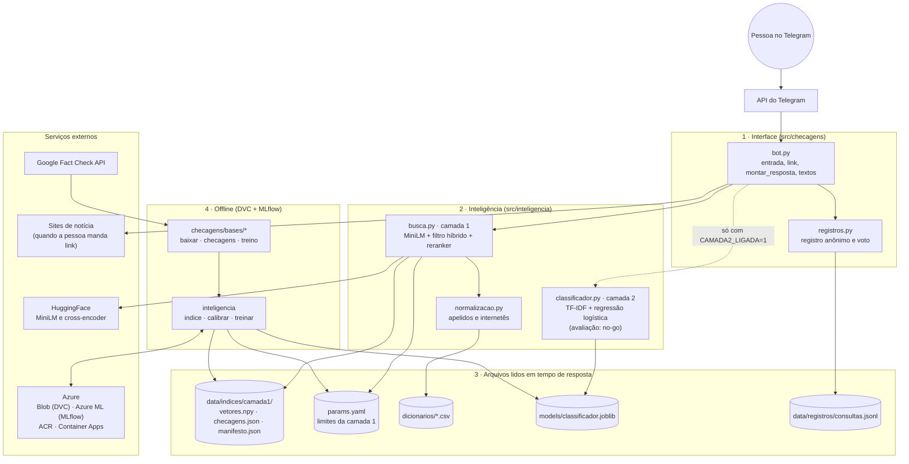
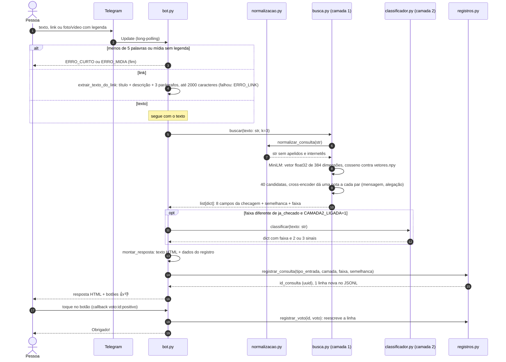

# Arquitetura do bot

> Mapa de como as peças se ligam: do que a pessoa manda no Telegram até a resposta, e de onde vêm os arquivos que o bot lê.
> Detalhes das bases ficam em [Dados do bot](dados.md).

O bot tem duas partes que rodam em momentos diferentes:

- **Em tempo de resposta** (cada mensagem): o processo `python -m checagens.bot` recebe a mensagem e
  chama a **camada 1** (busca de checagens). Se nada for achado e a chave estiver ligada, chama a
  **camada 2** (sinais de alerta). Monta o texto e grava um registro anônimo. Ele só **lê** arquivos
  prontos: índice, modelo, `params.yaml` e dicionários.
- **Offline** (quando os dados ou o código mudam): o pipeline do DVC (`dvc repro`) baixa as bases,
  gera o índice, calibra os limites e treina o classificador. O CI leva esses arquivos para a imagem
  Docker que roda no Azure.

## 1. Camadas

| Camada | Módulos | Quem fez (git) |
| --- | --- | --- |
| Interface | [`bot.py`](https://github.com/gpaulovit/RES-IA-Challenge-1/blob/main/src/checagens/bot.py): handlers, extração de link, `montar_resposta`, textos de produto, `carregar_camadas` | anajbsouza |
| Registro e monitoramento | [`registros.py`](https://github.com/gpaulovit/RES-IA-Challenge-1/blob/main/src/checagens/registros.py), [`scripts/testar_bot_terminal.py`](https://github.com/gpaulovit/RES-IA-Challenge-1/blob/main/scripts/testar_bot_terminal.py), [`scripts/medir_latencia.py`](https://github.com/gpaulovit/RES-IA-Challenge-1/blob/main/scripts/medir_latencia.py) | Ingrid Soares |
| Camada 1 (busca) | [`busca.py`](https://github.com/gpaulovit/RES-IA-Challenge-1/blob/main/src/inteligencia/busca.py), [`normalizacao.py`](https://github.com/gpaulovit/RES-IA-Challenge-1/blob/main/src/inteligencia/normalizacao.py), [`calibracao.py`](https://github.com/gpaulovit/RES-IA-Challenge-1/blob/main/src/inteligencia/calibracao.py) | gpaulovit (busca, calibração); anajbsouza (busca híbrida e reranker) |
| Camada 2 (sinais) | [`classificador.py`](https://github.com/gpaulovit/RES-IA-Challenge-1/blob/main/src/inteligencia/classificador.py), [`treino.py`](https://github.com/gpaulovit/RES-IA-Challenge-1/blob/main/src/inteligencia/treino.py) | gpaulovit; Ingrid Soares (MLflow, `ClassificadorPyFunc`) |
| Dados | [`src/checagens/bases/`](https://github.com/gpaulovit/RES-IA-Challenge-1/tree/main/src/checagens/bases), [`dvc.yaml`](https://github.com/gpaulovit/RES-IA-Challenge-1/blob/main/dvc.yaml) | cibelinda; anajbsouza (Google Fact Check) |
| DevOps e MLOps | `.dvc/config`, `Dockerfile`, `.github/workflows/ci.yml`, `scripts/promover_modelo.py`, `scripts/baixar_artefatos_deploy.py` | Ingrid Soares |
| Pesquisa | [`experiments/`](https://github.com/gpaulovit/RES-IA-Challenge-1/tree/main/experiments) (notebooks, modelos, reescritas) | gpaulovit |

## 2. Da mensagem à resposta

### Camada 1: como a busca decide

1. **Normaliza a consulta.** Troca apelidos e internetês por dicionário (`Xandão` vira `Alexandre de Moraes`, `ñ` vira `não`).
2. **Vetoriza.** O MiniLM multilíngue (`paraphrase-multilingual-MiniLM-L12-v2`, revisão fixada) transforma o texto num vetor de 384 números.
3. **Compara.** Calcula o cosseno contra os vetores pré-calculados de todas as checagens (k-NN exato). Esse cosseno é o campo `semelhanca`.
4. **Escolhe candidatas.** Junta as 20 melhores pelo cosseno com as 20 melhores pelo cosseno somado à **cobertura do assunto**. A cobertura mede quanto das palavras da mensagem que não são nomes aparece na checagem, pesando mais as palavras raras.
5. **Reranqueia.** Um cross-encoder (`mmarco-mMiniLMv2-L12-H384-v1`) lê mensagem e checagem juntas e dá uma nota de "falam da mesma coisa". A ordem passa a vir dessa nota.
6. **Define a faixa.**

| Faixa | Condição | Texto do bot |
| --- | --- | --- |
| `ja_checado` | nota ≥ 9, cosseno ≥ `limite_alta` (`params.yaml`) e a mesma negação nos dois textos (RN-06) | `JA_CHECADO` |
| `relacionada` | nota ≥ 4 | `RELACIONADA` (+ alerta curto da camada 2, se ligada) |
| `baixa` | o resto | camada 2, se ligada; senão `NAO_ENCONTREI` |

Se o índice estiver faltando ou não bater com o manifesto (sha256), `buscar` levanta `ValueError`. O bot
trata isso como "não encontrei" e registra o erro no log.

### Camada 2: como o classificador decide

O `classificador.joblib` (TF-IDF de 1 e 2 palavras + regressão logística) dá a probabilidade de a mensagem
ser falsa. Esse número **nunca sai** do módulo (RNF-06). Os cortes 0,527 e 0,483, tirados só do treino por
validação cruzada, viram as faixas `muitos_sinais`, `incerto` e `poucos_sinais`. Os `sinais` são os 2 ou 3
termos do próprio texto que mais pesaram na direção da faixa, sem palavras vazias.

A [avaliação pré-registrada](relatorio-camada2.md) deu **no-go**: F1 macro de 0,673, abaixo de 0,75, e
falso alarme de 30,8%, acima de 15%. Pela RN-04, o bot deve ir ao ar só com a camada 1.

## 3. De onde vêm os arquivos (offline)

```mermaid
flowchart LR
  subgraph fontes["Fontes"]
    f1["6 datasets públicos<br/>URL fixada por commit + sha256<br/>(fontes.py)"]
    f2["Google Fact Check API<br/>atualizar_checagens_factcheck.py"]
    f3["data/testes_benchmark.json<br/>62 mensagens"]
  end

  f1 -->|baixar| brutos[("data/brutos/<br/>CSV · TSV · ZIP")]
  f2 --> gfc[("data/externos/<br/>google_factcheck.json")]
  brutos -->|checagens| chk[("checagens.json<br/>amostra_teste_30.json<br/>relatorios/checagens.json")]
  gfc -->|checagens| chk
  brutos -->|"treino --corte 2018-09-15"| csv[("treino.csv · teste.csv · teste_curtos.csv<br/>relatorios/treino.json")]
  chk -->|indice| idx[("data/indices/camada1/<br/>vetores.npy · checagens.json · manifesto.json")]
  idx -->|calibrar| cal[("calibracao_camada1.csv<br/>calibracao_camada1_casos.csv")]
  f3 --> cal
  cal -. "--gravar" .-> params[("params.yaml")]
  params -->|"camada2 + semente"| mdl
  csv -->|treinar| mdl[("models/classificador.joblib<br/>metricas_camada2.json · params_camada2.json")]

  subgraph azure["Azure"]
    blob[("Blob: remote do DVC")]
    aml["Azure ML: MLflow<br/>modelo checagens-camada2"]
    promo["promover_modelo.py<br/>alias @producao"]
    img["CI: docker build<br/>imagem autocontida"]
    aca["ACR → Container Apps<br/>aca-res-ia-bot"]
  end

  idx -->|dvc push| blob
  mdl -->|"com MLFLOW_TRACKING_URI"| aml
  aml --> promo
  blob -->|"dvc pull no CI"| img
  promo -->|"@producao no CI"| img
  img --> aca
```

Comando único: `dvc repro` (ou um estágio, como `dvc repro treinar`). Resultados pequenos (CSV/JSON de
métricas e relatórios) ficam no git; dados brutos, índice e modelo ficam no cache do DVC (Azure Blob).
O deploy roda a cada push na `main`: testes, depois `baixar_artefatos_deploy.py`, `docker build`,
push no ACR e `az containerapp update`.

## 4. Contratos entre as partes

| Contrato | Formato | Quem produz → quem usa |
| --- | --- | --- |
| `buscar(texto: str, k: int = 3) -> list[dict]` | cada item: `id`, `alegacao`, `veredito_original`, `veredito_normalizado`, `agencia`, `data` (AAAA-MM-DD), `link`, `fonte_dataset`, `semelhanca` (cosseno 0–1), `faixa` | camada 1 → bot |
| `classificar(texto: str) -> dict` | `{"faixa": "muitos_sinais" \| "incerto" \| "poucos_sinais", "sinais": [2 ou 3 termos]}` | camada 2 → bot |
| `checagens.json` | lista de objetos com os 8 campos acima; `veredito_normalizado` ∈ falso, enganoso, verdadeiro, outro; sem link ou alegação repetidos | Dados → `busca.py --construir` |
| `treino.csv`, `teste.csv`, `teste_curtos.csv` | colunas `texto`, `rotulo` (`falso`/`verdadeiro`), `fonte`, `data` | Dados → `treino.py` |
| `data/indices/camada1/` | `vetores.npy` (float32, n × 384), `checagens.json` (mesma ordem), `manifesto.json` (modelo, revisão, sha256 de cada arquivo) | `busca.py --construir` → `buscar` |
| `classificador.joblib` | `{"pipeline", "corte_alto", "corte_baixo"}` | `treino.py` → `classificar`; também empacotado como `ClassificadorPyFunc` no MLflow |
| `consultas.jsonl` | uma linha por consulta: `id_consulta`, `data_hora_utc`, `tipo_entrada`, `camada`, `faixa`, `semelhanca`, `voto` (+ `data_hora_voto_utc`); nunca nome, usuário, telefone ou id do Telegram (RN-03) | bot → monitoramento (`obter_metricas_monitoramento`) |

### Variáveis de ambiente

| Variável | Lida por | Efeito |
| --- | --- | --- |
| `TELEGRAM_BOT_TOKEN` ou `TELEGRAM_TOKEN` | `bot.py` | token do BotFather |
| `MODO_TESTE=1` | `bot.py` | usa o modelo de mentira (resultados inventados) para ver todas as respostas |
| `CAMADA2_LIGADA=1` | `bot.py` | liga a camada 2 (só depois de `go`, RN-04) |
| `CHECK_LOGS_PATH` | `registros.py` | caminho do JSONL de registros |
| `FACTCHECK_API_KEY` | `atualizar_checagens_factcheck.py` | chave da Google Fact Check API |
| `MLFLOW_TRACKING_URI` | `treino.py`, `promover_modelo.py`, `baixar_artefatos_deploy.py` | liga o registro no Azure ML; vazio = treino offline |
| `AZURE_STORAGE_CONNECTION_STRING` | DVC (no CI) | acesso ao remote do DVC |
