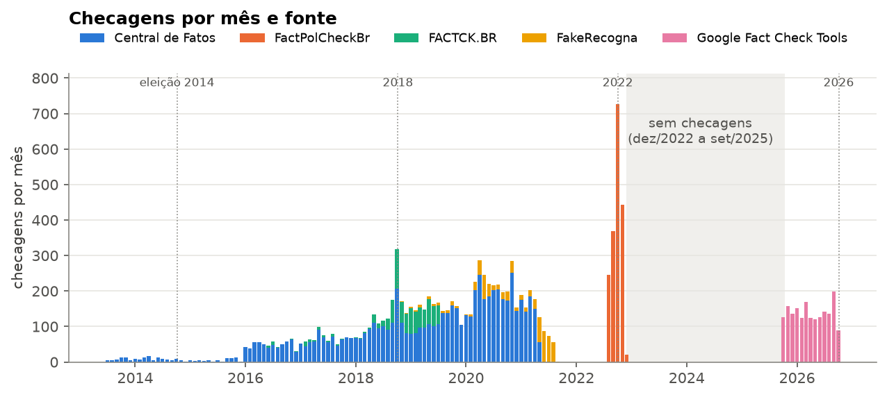
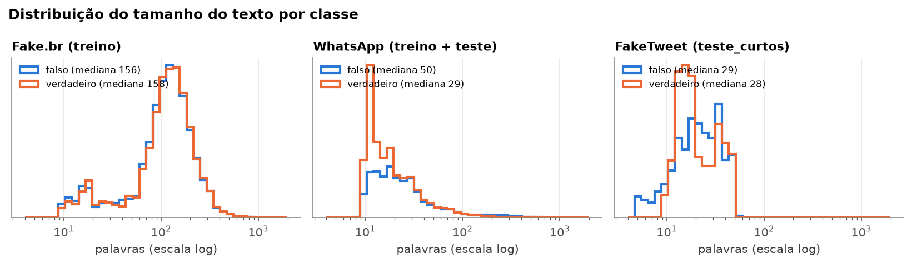

# Dados do bot

> Responsável: Cibelly Lourenço (`papel: dominio-dados`). Issue
> [#35](https://github.com/gpaulovit/RES-IA-Challenge-1/issues/35).

O bot usa duas bases, geradas por código em
[`src/checagens/bases/`](https://github.com/gpaulovit/RES-IA-Challenge-1/tree/main/src/checagens/bases)
a partir de datasets públicos (versão fixada por commit e conferida por sha256).

| Arquivo | Uso | Linhas | Período |
| --- | --- | ---: | --- |
| `data/processados/checagens/checagens.json` | busca (camada 1) | 12.245 | 07/2013 a 10/2026 |
| `data/processados/treino/treino.csv` | treino do classificador (camada 2) | 9.934 | 2009 a 15/09/2018 |
| `data/processados/treino/teste.csv` | teste do classificador | 3.295 | 16/09 a 28/10/2018 |
| `data/processados/treino/teste_curtos.csv` | teste extra, textos curtos | 297 | 2010 a 2019 |

Todas as contagens vêm de [`data/relatorios/checagens.json`](https://github.com/gpaulovit/RES-IA-Challenge-1/blob/main/data/relatorios/checagens.json)
e [`data/relatorios/treino.json`](https://github.com/gpaulovit/RES-IA-Challenge-1/blob/main/data/relatorios/treino.json),
gerados junto com as bases.

## Como regenerar

O DVC ainda não tem remote, então as bases são geradas do zero (baixa cerca de 130 MB):

```sh
pip install -e '.[test]' 'dvc>=3,<4'
dvc repro checagens treino
```

Os scripts são idempotentes (semente fixa 42). As regras são testadas em `tests/test_bases.py`.

## Base de checagens (camada 1)

Cada registro tem `id`, `alegacao`, `veredito_original` (o rótulo exatamente como a agência
publicou, RN-01), `veredito_normalizado` (`falso`, `enganoso`, `verdadeiro` ou `outro`, RN-02),
`agencia`, `data`, `link` e `fonte_dataset`.

| Fonte | Na base | Período |
| --- | ---: | --- |
| [FactChecks.br](https://github.com/fake-news-UFG/FactChecks.br) / Central de Fatos | 7.035 | 2013 a 2021 |
| [FactPolCheckBr](https://github.com/Interfaces-UFSCAR/Dataset-FactPolCheckBr) | 1.804 | ago a dez/2022 |
| [Google Fact Check Tools](https://toolbox.google.com/factcheck/explorer) | 1.803 | out/2025 a out/2026 |
| [FACTCK.BR](https://github.com/jghm-f/FACTCK.BR) | 885 | 2016 a 2019 |
| FactChecks.br / FakeRecogna | 718 | 2018 a 2021 |

**Regras principais** (detalhes no código e no relatório):
- **Veredito:** só vale o rótulo publicado pela agência. Do FactChecks.br, que só tem `is_fake`,
  entra apenas o registro com carimbo explícito no título ("#boato", "É #FAKE", "É falso"…).
  Mapeamento em `TAXONOMIA` e `CARIMBOS`, em `vereditos.py`.
- **Descartes:** saem registros sem link, data ou veredito e checagens de várias alegações num link
  só. Dos 27.249 registros lidos, 12.236 são descartados.
- **Duplicatas:** saem 2.768, por link normalizado ou alegação normalizada. Fica a fonte com o
  rótulo mais rico (`deduplicar()` em `checagens.py`).
- **Atualização:** as checagens de 2025-26 vêm de `scripts/atualizar_checagens_factcheck.py`, que
  grava `data/externos/google_factcheck.json`.

## Base de treino (camada 2)

Colunas: `texto` (sem carimbos de rótulo), `rotulo` (`falso` ou `verdadeiro`), `fonte` e `data`.

| Arquivo | Fonte | Linhas | % falso |
| --- | --- | ---: | ---: |
| `treino.csv` | [Fake.br-Corpus](https://github.com/roneysco/Fake.br-Corpus) (notícias) | 7.199 | 50% |
| `treino.csv` | [FakeWhatsApp.Br](https://github.com/cabrau/FakeWhatsApp.Br) (até 15/09/2018) | 2.735 | 42% |
| `teste.csv` | FakeWhatsApp.Br (16/09 a 28/10/2018) | 3.295 | 49% |
| `teste_curtos.csv` | [FakeTweet.Br](https://github.com/prc992/FakeTweet.Br) | 297 | 67% |

- **Divisão temporal (RN-04):** o teste é posterior ao treino e vem do canal que o bot recebe
  (mensagens de grupo). A data de corte é o `--corte` do stage `treino` no `dvc.yaml`.
- **Sem vazamento direto:** nenhum texto se repete entre arquivos. Também saem as quase-duplicatas
  do teste (cosseno ≥ 0,9 com o treino) e os carimbos que entregam o rótulo ("é fake", "#boato",
  links de agência). Tudo é conferido por `verificar()` em `treino.py`.
- **Privacidade (RN-03):** do WhatsApp entram só texto, rótulo e data.

## Análise exploratória

Notebook: [`experiments/07_eda.ipynb`](https://github.com/gpaulovit/RES-IA-Challenge-1/blob/main/experiments/07_eda.ipynb).
Figuras em `docs/img/eda/`.



- **Buraco de quase três anos:** não há checagens entre dez/2022 e set/2025.
- **94% `falso`**, e o **Boatos.org é 46% da base**. Só o Google Fact Check e o FACTCK.BR têm
  variedade de veredito.
- **Urna e sistema eleitoral** é 17% das checagens de 2022, o tipo de boato mais provável de voltar
  em 2026.
- **34-44% das alegações do FactPolCheckBr e do FACTCK.BR são desmentidos** ("Lula não disse
  que…"). Com a regra de negação da camada 1, elas tendem a sair como "notícia parecida".



- **No WhatsApp, as falsas têm o dobro do tamanho** das verdadeiras. Só o tamanho já separa as
  classes (AUC 0,63 a 0,67).
- **No Fake.br, o ano separa as classes** (AUC 0,76): falsas de 2015 a 2017, verdadeiras de 2017-18.
- **"Verdadeiro" muda de sentido entre fontes.** No Fake.br é notícia de jornal. No WhatsApp é
  mensagem que não é desinformação (convites para grupos, propaganda de candidatos locais).
- **O benchmark do bot usa frases curtas** (12 a 15 palavras), enquanto mensagens reais de WhatsApp
  têm de 30 a 57.

## Limitações

- **Sem checagens de dez/2022 a set/2025**, e as de 2025-26 vêm de só 5 agências.
- **Quase tudo é `falso`:** uma correspondência na busca quase sempre devolve "falso".
- **A alegação às vezes é o desmentido, não o boato.**
- **A base de treino ensina veículo, época e tamanho**, não só desinformação. Isso ajuda a explicar o
  no-go da camada 2 ([relatório](relatorio-camada2.md)).
- **Teste otimista:** é do mesmo canal e de semanas próximas ao treino, e tudo é de 2018.

## Licenças e pendências

| Dataset | Licença |
| --- | --- |
| FactPolCheckBr | CC BY-NC-SA 4.0 (atribuição, não comercial, mesma licença) |
| FACTCK.BR, FactChecks.br | MIT |
| FakeWhatsApp.Br | GPL-3.0 |
| Fake.br-Corpus, FakeTweet.Br, Central de Fatos, FakeRecogna, Google Fact Check API | a confirmar |

- Definir o remote do DVC.
- Confirmar as licenças em aberto.
- Revisar a `TAXONOMIA` em `vereditos.py`: "Fora de contexto" e "Comprovado" (Google) caem em
  `outro`, mas "Sem contexto" (FACTCK.BR) vira `enganoso`.
